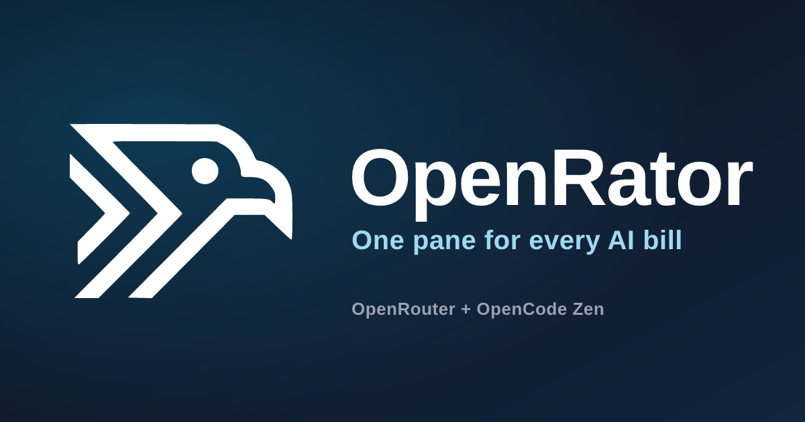

# OpenRator

**One pane for every AI bill.** OpenRator is an Android dashboard for the AI
providers you already use. See your credits, spend, usage windows, provider
policy, and API keys without opening a laptop.

Bring your own API key (BYOK). No account, no backend, no telemetry — your key
and your usage data stay on your phone.

## What you can do

- **See your balance at a glance.** Credits remaining, key limits, reset
  windows, and a 14-day spend trend on one home screen.
- **Understand where the money goes.** A 30-day spend chart plus breakdowns by
  endpoint, model, and provider, so an expensive agent or model is easy to spot.
- **Track subscription windows.** OpenCode Go's 5-hour, weekly, and monthly
  percentage windows are pulled live, with clear warning and danger thresholds.
- **Keep provider policy under control.** Browse the provider catalog and adjust
  routing rules from your phone.
- **Oversee your API keys.** List keys, check limits, and edit labels, limits, or
  reset windows.
- **Work across providers.** OpenRouter today, with OpenCode Go and OpenCode Zen
  available in the same app.

## Supported providers

| Provider | What OpenRator shows |
|---|---|
| **OpenRouter** | Credits, key limits, spend and endpoint analytics, provider policy, API keys |
| **OpenCode Go** | Live 5-hour / weekly / monthly subscription usage windows |
| **OpenCode Zen** | Pay-as-you-go usage with optional manual monthly tracking |

## Install

OpenRator requires **Android 12 or newer** and is distributed as a signed APK
for sideloading.

1. Open the [Releases](https://github.com/brrrassica/openrator/releases) page.
2. Download the latest `openrator-<version>.apk`.
3. Open the file on your phone and allow installation from your browser or file
   manager when Android asks.

OpenRator is not on Google Play. You can verify the download against the
SHA-256 checksum published with each release.

## Your data stays on your phone

- **Your key never leaves the device** except in requests to the provider you
  configured. It is stored in Android's secure keystore.
- **No account and no backend.** There is no OpenRator server to sign in to.
- **No analytics or tracking SDKs.** Nothing is collected or shared.
- **Direct connections only.** The app talks to the provider APIs you use and
  nowhere else.

## Get help

Found a bug or have a feature request? Open an issue at
[github.com/brrrassica/openrator/issues](https://github.com/brrrassica/openrator/issues).

## License

OpenRator is released under the [0BSD license](apps/mobile/LICENSE).
