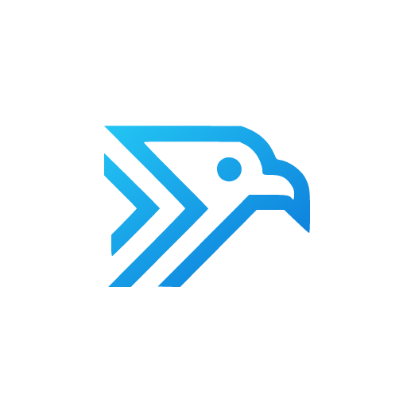
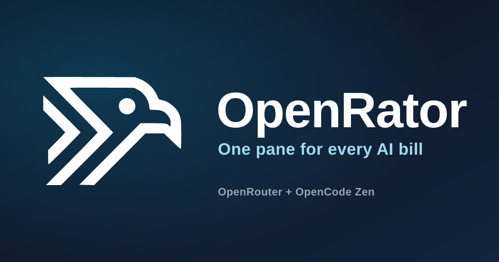
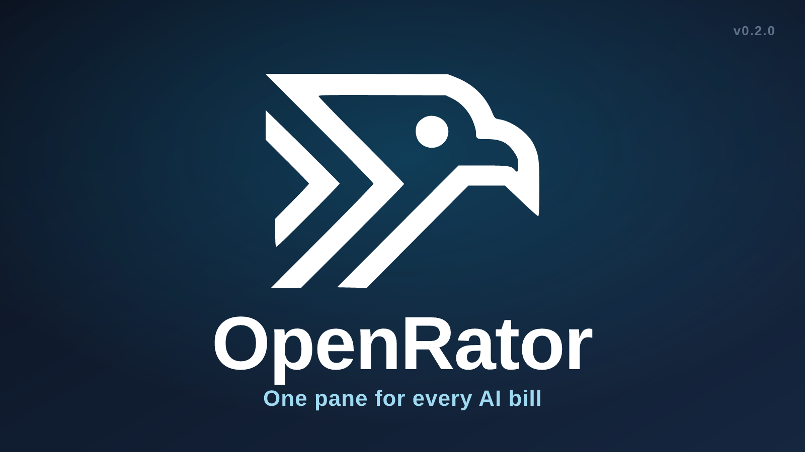
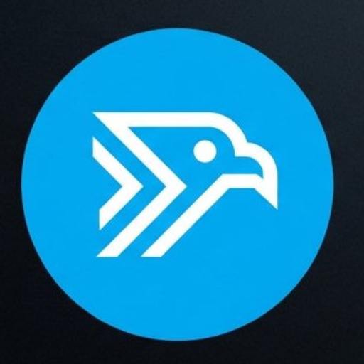
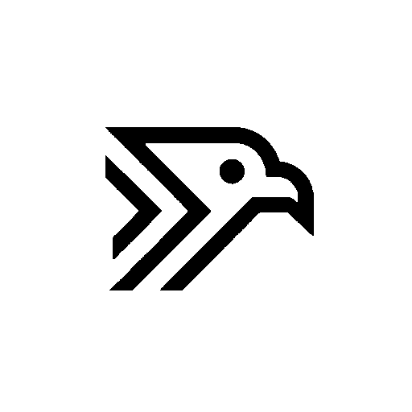
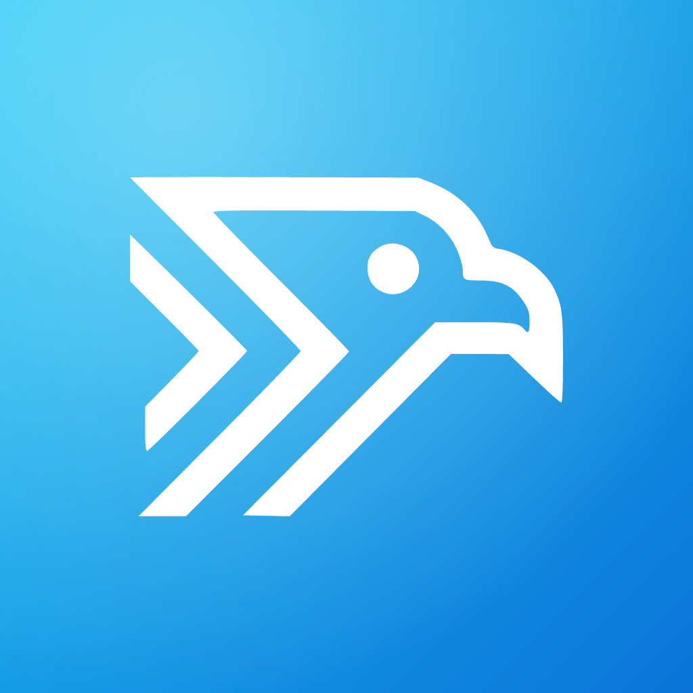

# OpenRator asset index (v0.2)

Every raster in this directory and in `apps/mobile/assets` is generated from the
committed SVG masters in [`brand/svg`](../../brand/svg). Do not hand-edit the
PNGs; edit the master and run `npm run assets:build` from `apps/mobile`.

See [`docs/06-brand-guide.md`](../06-brand-guide.md) for palette, clear space,
typography, icon grid, and trademark rules.

---

## Marks




- `mark-512.png` — duotone mark on transparent
- `mark-monochrome-512.png` — monochrome mark on transparent

## Wordmark and lockups


- `wordmark.png` — wordmark only
- `lockup-horizontal.png` — mark + wordmark + tagline
- `lockup-stacked.png` — stacked mark + wordmark + tagline

## Social and release art





- `social-preview.png` — 1200×630 link preview and README hero
- `release-banner.png` — 1600×900 release-note and announcement banner

## Source artwork




- `brand/source-mark.png` — crop of the approved artwork
- `brand/source-mark-bw.png` — thresholded reference used by potrace

## Mobile app assets








| Asset | Path | Notes |
|---|---|---|
| App icon | `apps/mobile/assets/icon.png` | 1024×1024, full-bleed |
| Adaptive foreground | `apps/mobile/assets/android-icon-foreground.png` | 1024×1024, 66 dp safe zone |
| Adaptive background | `apps/mobile/assets/android-icon-background.png` | 1024×1024 gradient |
| Monochrome | `apps/mobile/assets/android-icon-monochrome.png` | 1024×1024, OS-tinted |
| Splash | `apps/mobile/assets/splash-icon.png` | 1024×1024, white mark |
| Favicon | `apps/mobile/assets/favicon.png` | 48×48 |
| Notification | `apps/mobile/assets/notification-icon.png` | 96×96, white on transparent |

## Regeneration and verification

```sh
node scripts/brand/make-masters.mjs   # masters from the approved trace
cd apps/mobile
npm run assets:build                  # write every PNG
npm run assets:check                  # fail on drift (CI gate)
```

- Trace source: [`brand/generated/mark-trace.svg`](../../brand/generated/mark-trace.svg)
- Approved source: [`brand/source/openrator.jpeg`](../../brand/source/openrator.jpeg)
- Font: [`brand/fonts/LiberationSans-Bold.ttf`](../../brand/fonts/LiberationSans-Bold.ttf) (SIL OFL 1.1)
